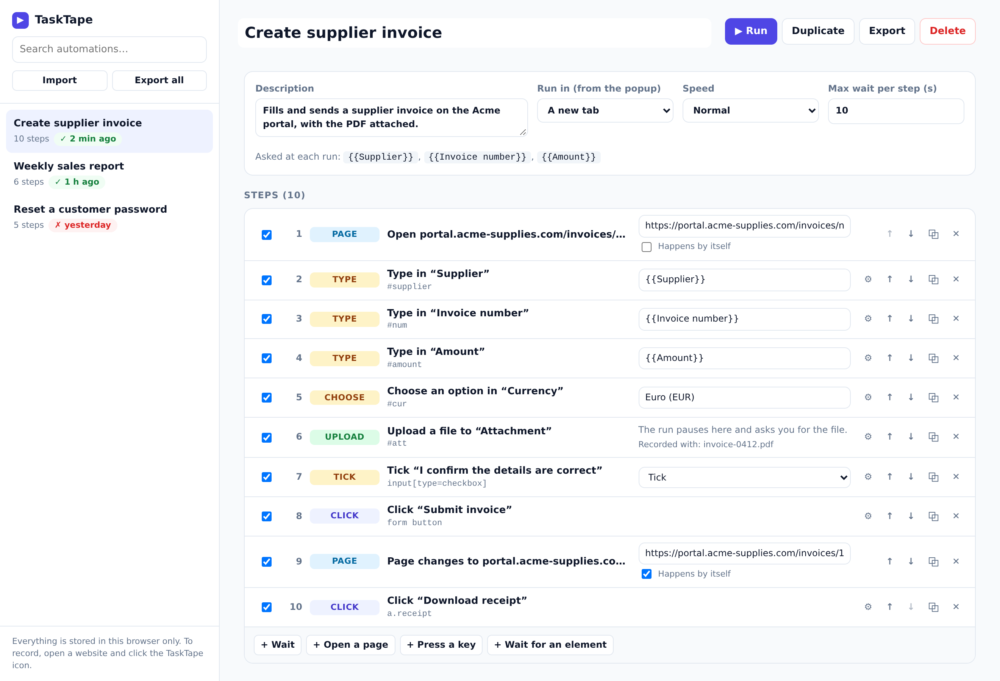
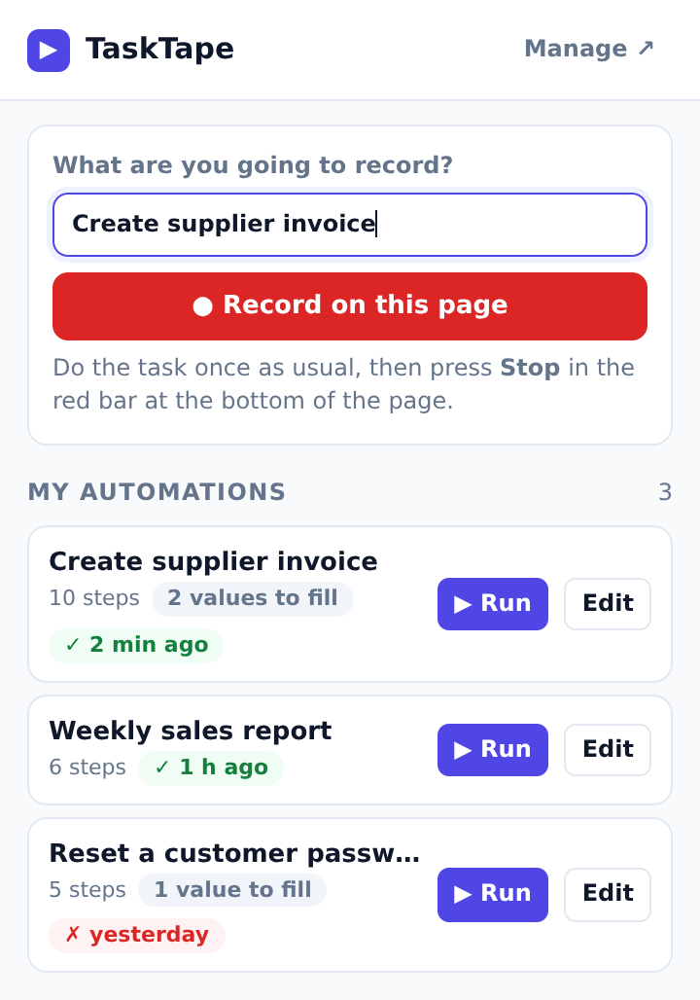
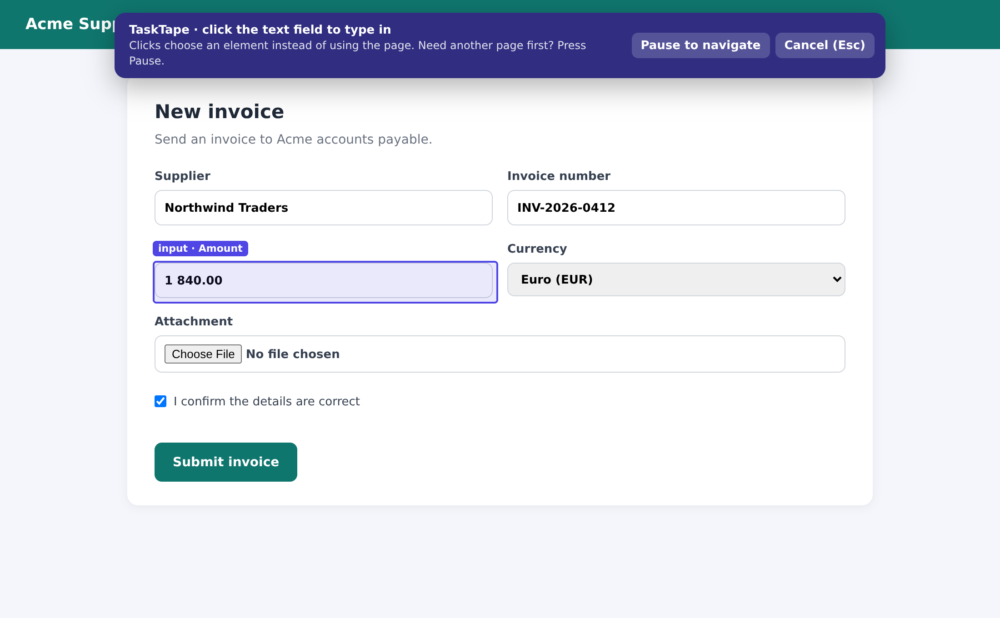

# TaskTape

**Record the browser tasks you repeat every day, then replay them in one click.**

TaskTape is a free browser extension for people who do the same clicks and typing again and again: filling the same form, downloading the same report, creating the same ticket. Record the task once. Next time, press ▶ Run and watch TaskTape do it.

No account, no server, no coding. Everything stays in your browser.

**[➜ Install TaskTape from the Chrome Web Store](https://chromewebstore.google.com/detail/mhpnjpbjcionekcakioncjgpjbidlhgb)** (Chrome and Edge, free)

## Features

- **One-click recording** of clicks, typing, drop-downs, checkboxes, the Enter/Escape keys, form submissions and page changes.
- **Reliable replay:** TaskTape waits for slow pages and elements, and scrolls to elements lower down the page by itself.
- **Recorded or asked values:** keep the value you typed while recording, or let TaskTape **ask before each run** (an invoice number, a customer name…). Passwords are **never stored** and are always asked.
- **File uploads:** the run pauses and asks you to choose the file, then continues. Files are never stored.
- **Step editor:** rename, reorder, disable, duplicate or delete steps. Add new steps by simply **clicking the element on the website**.
- **Scroll steps** for pages that load more content as you scroll.
- **Run history** showing which step failed and why.
- **Import / export** to share automations with colleagues.

## Install

- **Chrome:** [Chrome Web Store](https://chromewebstore.google.com/detail/mhpnjpbjcionekcakioncjgpjbidlhgb) → **Add to Chrome**.
- **Microsoft Edge:** open the same [Chrome Web Store page](https://chromewebstore.google.com/detail/mhpnjpbjcionekcakioncjgpjbidlhgb). If Edge asks, click **Allow extensions from other stores**, then **Add to Chrome**.
- **Firefox:** coming soon on Firefox Add-ons.

Then pin the TaskTape icon in your toolbar (puzzle-piece icon → 📌).

## How to use

1. Open the website where your task starts.
2. Click the TaskTape icon, name your task and press **● Record on this page**.
3. Do the task once, normally.
4. Press **■ Stop** in the red bar at the bottom right of the page. The manager opens with your recorded steps.
5. Check the steps, then press **▶ Run**.

  

While recording, a red bar shows how many steps were captured. You can add a pause with **+ Wait 2s** or finish with **■ Stop**.

### Values that change at each run

Each **Type** and **Choose** step has a switch in the manager:

- **Recorded value:** the text typed (or the option chosen) while recording is used every time.
- **Ask each run:** TaskTape asks for the value before each run, and suggests the value you recorded.

The run form is pre-filled with your last answer. Steps with the same question share one answer, so "Customer email" typed in two places is asked only once.

### Adding steps by hand

You don't have to record everything again. At the bottom of the step list, choose where the new step goes, then pick a step type:

- **On the page:** Click, Type text, Choose an option, Tick a box, Upload a file, Submit a form, Wait for an element
- **Other:** Open a page, Scroll, Press a key, Wait

For steps on the page, press **🎯 Choose it on …**. TaskTape switches to the website tab, and a purple bar asks you to **click the element**. Once you do, you're back in the manager. Need to reach another page first? Press **Pause to navigate**, then **Resume picking**. Press Esc to cancel.

The 🎯 button on any step lets you pick its element again. It's the easiest fix when a website changed and a step can't find its element anymore.

### Scrolling

You don't need a Scroll step for a button lower down the page: TaskTape scrolls to it by itself.

Add a **Scroll** step only for pages that **load more content as you scroll** (endless lists, "load more" feeds). Put it before the step that needs that content:

- **To the bottom (loads more):** keeps scrolling while new content appears.
- **Until an element appears:** scrolls until the element you chose (🎯) is on the page.
- **To the top** / **By an amount.**

### File uploads

When you pick a file during a recording, TaskTape records an **Upload** step and remembers only the file name.

On each run, TaskTape pauses at that step and shows a **Choose the file** panel. Pick a file or drop one onto the panel, and the run continues. You can also **Skip this step** or **Stop the run**.

### Tips for reliable automations

- Use **Slow** speed while testing, then switch to **Normal** or **Fast**.
- If a step can't find its element, press 🎯 on that step and click the element again.
- Add a **Wait** or **Wait for an element** step after actions that take time, such as generating a report.

## Limitations

- Browser pages (settings, extensions pages) and the add-on stores can't be automated, by the browsers' own rules.
- Elements inside embedded frames (iframes) are not recorded yet.
- Drag-and-drop, hover menus and right-clicks are not recorded.
- Captchas and two-factor codes must be completed by a person.
- Keep the replay tab open until the run finishes.

## Privacy

TaskTape has no server, no account and no analytics, and sends nothing anywhere. Your automations and run history are stored in your browser only. Passwords typed during a recording are never saved. See the [privacy policy](PRIVACY.md).

## Help and feedback

- 🐞 **Something doesn't work?** [Report a problem](https://github.com/uuduru/TaskTape/issues/new?template=bug_report.yml). You can also use the **Report a problem** link at the bottom of the manager.
- 💡 **An idea?** [Suggest a feature](https://github.com/uuduru/TaskTape/issues/new?template=feature_request.yml).
- ❓ **A question?** [Ask in Discussions](https://github.com/uuduru/TaskTape/discussions).
- 🔒 **A security problem?** [Report it privately](https://github.com/uuduru/TaskTape/security/advisories/new).

Reports are public: don't paste passwords, personal data or private company addresses.

Want to help improve TaskTape? See [CONTRIBUTING.md](CONTRIBUTING.md).

## License

Free and open source under the [MIT License](LICENSE). Made by [@uuduru](https://github.com/uuduru).
