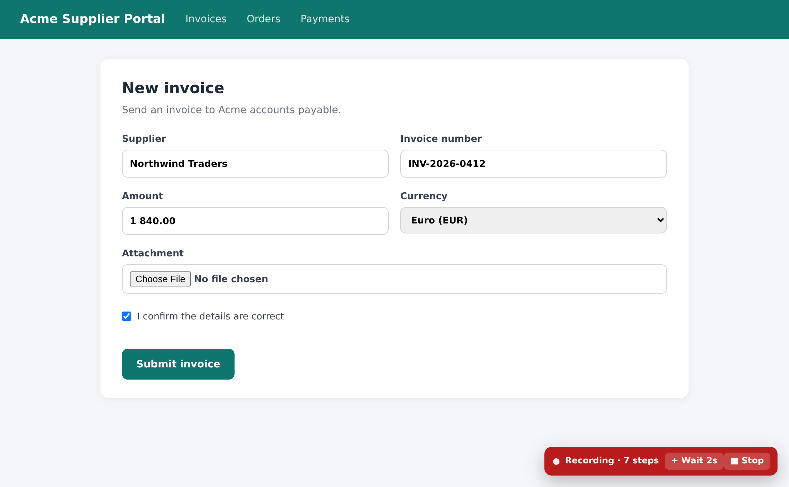
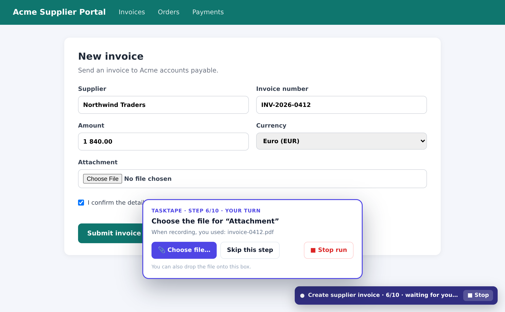

# TaskTape

**Record the browser tasks you repeat every day, then replay them in one click.**

TaskTape is a browser extension for **Chrome, Edge and Firefox**, for people who do the same clicks and typing again and again: filling the same form, downloading the same report, creating the same ticket. Record the task once; next time, press ▶ Run and watch TaskTape do it.

No account, no server, no coding. Everything stays in your browser.

**[➜ Install TaskTape from the Chrome Web Store](https://chromewebstore.google.com/detail/mhpnjpbjcionekcakioncjgpjbidlhgb)** (Chrome and Edge, free)


## Features

- **One-click recording** of clicks, typing, drop-downs, checkboxes, the Enter/Escape keys, form submissions and page changes. Elements lower down the page are scrolled into view automatically, and a **Scroll** step handles pages that load more content as you scroll.
- **Reliable replay**: each element is remembered several ways (test ids, id, name, label, link, text, position). TaskTape waits for slow pages and elements before acting.
- **Recorded or asked values**: for each typed text or chosen option, keep the recorded value, or switch to **Ask each run** and TaskTape asks before running, suggesting the recorded value. Recorded passwords are **never stored** and are always asked.
- **File uploads**: when a step needs a file, the run pauses and a panel in the page asks you to choose it (or drop it). The run continues as soon as the file is attached. Files are never stored.
- **Step editor**: rename, reorder, disable, duplicate or delete steps, and change typed text or chosen options. Add any type of step by hand (click, type, choose, tick, upload, submit, wait, open a page, press a key) by simply **clicking the element on the website**.
- **Run history** with the step that failed and why.
- **Import / export** as `.json` to share automations with colleagues.
- **On-page bar** while recording or running, with a Stop button.

## Install

**Chrome / Edge:** install it from the [Chrome Web Store](https://chromewebstore.google.com/detail/mhpnjpbjcionekcakioncjgpjbidlhgb) (Edge accepts Chrome Web Store extensions after you click "Allow extensions from other stores").

**Firefox:** coming soon on addons.mozilla.org. Until then, use developer mode below.

## Install from the source code (developer mode)

The same folder works in every browser below. Download or clone it first. If you also installed TaskTape from a store, disable that copy while testing, or you'll have two TaskTape icons.

### Chrome / Edge

1. Open `chrome://extensions` in Chrome (or `edge://extensions` in Microsoft Edge).
2. Turn on **Developer mode** (top right).
3. Click **Load unpacked** and select the `TaskTape` folder.
4. Pin the TaskTape icon in the toolbar.

After changing the code, click the ↻ reload button on the extension card.

### Firefox (121 or newer)

1. Open `about:debugging#/runtime/this-firefox`.
2. Click **Load Temporary Add-on…** and select the `manifest.json` file in the `TaskTape` folder.
3. Pin the TaskTape icon: click the puzzle-piece icon in the toolbar → ⚙ next to TaskTape → **Pin to Toolbar**.
4. The first time you press Record or Run, Firefox may ask you to let TaskTape **access your data for all websites**. Allow it, because TaskTape can't record or replay on websites without it. You can also allow it beforehand under `about:addons` → TaskTape → **Permissions**.

A temporary add-on is removed when Firefox restarts. To keep it installed, use the signed version from addons.mozilla.org (see [Publishing](#publishing)). After changing the code, click **Reload** on the add-on in `about:debugging`.

## How to use

1. Open the website where your task starts.
2. Click the TaskTape icon, name your task and press **● Record on this page**.
3. Do the task once, normally.
4. Press **■ Stop** in the red bar at the bottom right of the page. The manager opens with your recorded steps.
5. Check the steps, then press **▶ Run**.

<p align="center">
  
</p>

While recording, a red bar shows how many steps were captured. You can add a pause with **+ Wait 2s** or finish with **■ Stop**.



### Values that change at each run

Each **Type** and **Choose** step has a switch in the manager:

- **Recorded value**: the text typed (or the option chosen) while recording is used every time.
- **Ask each run**: TaskTape asks for the value before each run. The question is named after the field (you can rename it), and the recorded value is offered as the suggested answer.

The run form is pre-filled with the last answer you gave, or with the suggestion the first time. Steps with the same question share one answer, so "Customer email" typed in two places is asked only once. Passwords are always asked and never stored or suggested.

Advanced users can also mix fixed text and questions in one value, for example `Order {{Order number}} – urgent`.

### Adding steps by hand

You don't have to record everything again. At the bottom of the step list, choose where the step goes (**Add a step** at the end or after a given step), then pick a step type:

- **On the page:** Click, Type text, Choose an option, Tick a box, Upload a file, Submit a form, Wait for an element
- **Other:** Open a page, Scroll, Press a key, Wait

For steps on the page, you choose the element on the website itself, not in the manager. Press **🎯 Choose it on …** and TaskTape switches to the website tab for you. It uses the tab already open on that page, else one on the same site, else it opens the page. A purple bar at the top of the website asks you to **click the element**, and once you do, you're brought back to the manager. The element under the mouse is highlighted with its name. Clicking a label or a custom "Upload" button finds the real field behind it. Need to reach another page first? Press **Pause to navigate**, then **Resume picking**. Press Esc to cancel.


The 🎯 button on any step lets you pick its element again. This is the easiest fix when a website changed and a step can't find its element anymore. A step without an element is highlighted, and the automation won't run until one is picked.

### Scrolling

You don't need to scroll for a button lower down the page. TaskTape finds it and scrolls it into view by itself before clicking, typing or ticking.

Add a **Scroll** step only for pages that **load more content as you scroll** (endless lists, "load more" feeds, lazy tables). Put it before the step that needs that content:

- **To the bottom (loads more):** keeps scrolling while new content appears, then stops when the page stops growing.
- **Until an element appears:** scrolls down until the element you chose (🎯) is on the page. This is the best choice when you know what you're looking for.
- **To the top** / **By an amount** (in pixels, negative to scroll up).

It also works on web apps that scroll inside a panel rather than the whole page. A Scroll step can take up to 30 seconds by default. For very long lists, raise it with ⚙ → **Max wait**.

### File uploads

When you pick a file during a recording, TaskTape records an **Upload** step and remembers only the file name, as a reminder.



On each run, TaskTape pauses at that step, brings the page to the front and shows a **Choose the file** panel. Pick a file or drop one onto the panel, and the run continues. You can also **Skip this step** or **Stop the run** from the panel. While waiting, the popup shows the run as paused, with a **Show the page** button. If no file is chosen within 30 minutes, the run stops.

Uploads must go through a normal file field on the page. Drop zones that accept only drag-and-drop are not supported yet.

### Tips for reliable automations

- Use **Slow** speed while testing, then switch to **Normal** or **Fast**.
- If a step can't find its element, press 🎯 on that step and click the element again. Advanced users can also open ⚙ to paste CSS selectors (one per line, most reliable first) or adjust the visible text used as a fallback.
- Add a **Wait** or **Wait for an element** step after actions that take time, such as generating a report.
- A step marked **Page · Happens by itself** waits for the page to change after the previous click. Untick it to make TaskTape open that address directly.

## Limitations

- Works on normal websites (`http`, `https`, and local files if you allow file access). Browser pages (`chrome://…`, `about:…`) and the add-on stores (Chrome Web Store, addons.mozilla.org) can't be automated, by the browsers' own rules.
- Elements inside iframes and closed shadow DOM are not recorded yet.
- Drag-and-drop (including drop-only upload zones), hovering menus and right-clicks are not recorded.
- Captchas and two-factor prompts must be completed by a person.
- Keep the replay tab open until the run finishes.

## Privacy

TaskTape makes no network requests of its own and has no analytics. Automations and run history are stored with `chrome.storage.local`, in your browser profile only. Passwords typed during a recording are replaced by a placeholder and never saved. See [PRIVACY.md](PRIVACY.md).

## Project structure

| File | Role |
| --- | --- |
| `manifest.json` | Extension definition (Manifest V3, one file for Chrome, Edge and Firefox) |
| `background.js` | Recording session, replay engine, run history (a service worker in Chrome/Edge, a background script in Firefox) |
| `content.js` | Injected into pages: records actions, executes steps, shows the on-page bar |
| `lib.js` | Shared helpers: storage, variables, step descriptions, import/export |
| `popup.html` / `popup.js` | Toolbar popup: record, run, list |
| `editor.html` / `editor.js` | Manager: edit steps, settings, history, import/export |
| `ui.css` | Shared styles |
| `icons/` | Icon source (`icon.svg`) and PNG sizes |
| `docs/images/` | Screenshots used in this README |
| `tests/` | Automated tests (`npm test`) |
| `web-ext-config.mjs` | Settings for Mozilla's `web-ext` tool (Firefox checks and the store package) |

## Development

You need [Node.js](https://nodejs.org) only for the tests and packaging, not to use the extension.

```bash
npm install            # once
npm test               # run the automated tests (recording, replay, uploads, picker, Chrome and Firefox modes)
npm run lint:firefox   # check the extension with Mozilla's rules
npm run start:firefox  # open Firefox with TaskTape loaded
npm run build          # create the zip to upload to the stores (in web-ext-artifacts/)
```

`npm run lint:firefox` shows one expected warning ("background.service_worker is not supported"). Firefox uses the `scripts` entry instead, and Chrome uses `service_worker`.

## Publishing

**Package**: run `npm run build`. The zip in `web-ext-artifacts/` contains only the extension's files and works for every store below.

**Chrome Web Store** (one-time developer fee):

1. In the Chrome Web Store developer dashboard, upload the zip, add screenshots (1280×800), a description and a link to `PRIVACY.md`.
2. Explain the permissions: **access to all sites** is needed to record and replay on any website the user chooses; **scripting** injects the recorder into tabs opened before installation; **storage** saves automations locally.

The same zip can be published on the **Microsoft Edge Add-ons** store.

**Firefox Add-ons (addons.mozilla.org, free)**:

1. Create a developer account on addons.mozilla.org and choose **Submit a New Add-on**.
2. Choose to list it on the site, upload the same zip, and answer the questions about data collection: TaskTape collects none.
3. Because the code is not minified, you don't need to send separate source code.
4. Mozilla reviews and signs the add-on. Firefox only allows signed add-ons to be installed permanently.

The add-on ID is `tasktape@uuduru` (in `manifest.json`). Keep it unchanged so updates reach existing users.

**Firefox, signed for yourself only (unlisted)**: this gets a permanent install without a public listing.

1. Sign in on addons.mozilla.org and create API keys at **Developer Hub → Tools → Manage API Keys** (`https://addons.mozilla.org/developers/addon/api/key/`). You get a *JWT issuer* and a *JWT secret*. Never commit them or share them.
2. In PowerShell, in the TaskTape folder:
   ```powershell
   npm install
   $env:WEB_EXT_API_KEY = "your JWT issuer"
   $env:WEB_EXT_API_SECRET = "your JWT secret"
   npm run sign:firefox
   ```
3. Mozilla checks the add-on automatically, usually within a few minutes. The signed file appears in `web-ext-artifacts/` as a `.xpi`.
4. Install it: open `about:addons`, click ⚙ → **Install Add-on From File…** and choose the `.xpi` (or drag the file onto a Firefox window). It stays installed after restarts.

Each upload to Mozilla needs a **new version number**, including between unlisted and listed. Increase `version` in `manifest.json` (for example `1.2.1`) before signing or submitting again.

## Ideas for next versions

- Scheduled runs (every morning at 9:00) with `chrome.alarms`
- Running an automation once per row of a CSV file
- Recording inside iframes
- Assertions such as "check that this text appears"
- A keyboard shortcut to run a favourite automation

## Help and feedback

- 🐞 **Something doesn't work?** [Report a problem](https://github.com/uuduru/TaskTape/issues/new?template=bug_report.yml). You can also use the **Report a problem** link at the bottom of the manager.
- 💡 **An idea?** [Suggest a feature](https://github.com/uuduru/TaskTape/issues/new?template=feature_request.yml).
- ❓ **A question?** [Ask in Discussions](https://github.com/uuduru/TaskTape/discussions).
- 🔒 **A security problem?** [Report it privately](https://github.com/uuduru/TaskTape/security/advisories/new) (see [SECURITY.md](SECURITY.md)).

Issues are public: don't paste passwords, personal data or private company URLs. Want to help? See [CONTRIBUTING.md](CONTRIBUTING.md).

## Author

Created by ([@uuduru](https://github.com/uuduru)).

## License

MIT © 2026. See [LICENSE](LICENSE).
